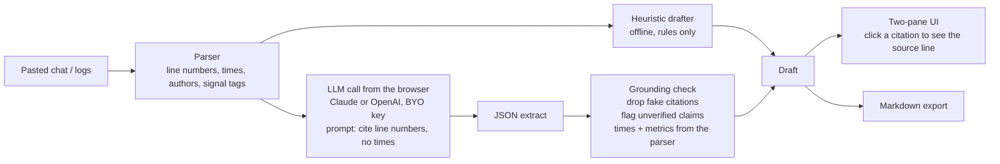

# PostmortemPilot

[](https://github.com/anujjjjjj/postmortem-pilot/actions/workflows/ci.yml)

**Paste an incident channel. Get a blameless postmortem where every claim links back to the line that supports it.**

**Live demo: https://postmortem-pilot.vercel.app** (offline mode works without a key; Claude/OpenAI modes use your own key, called from your browser)

After an incident, someone has to turn a messy Slack thread into a postmortem. It takes hours, so it often doesn't happen. LLMs can write the draft, but they get timestamps wrong and invent causes. That's the worst failure for a document people use to decide what to fix.

PostmortemPilot keeps the model away from anything that has a right answer somewhere else:

- **Timestamps and durations come from a deterministic parser**, not the model. Supported formats: `[14:03]`, `14:03:11`, ISO, 12h `2:03 PM`, and midnight rollover.
- **Every claim cites source lines.** Citations to lines that don't exist are removed. Claims with no support are marked **unverified**.
- **Offline mode** builds a draft with rules only. It's useful with no API key, and it's the baseline the AI draft is checked against.
- **No backend.** Your key and transcript go from your browser straight to Anthropic or OpenAI. The app is a static site.
- Click a citation to highlight the source line. Export Markdown in one click.



## What you get

- Detected / mitigated / resolved times, time to mitigate, and total duration
- Summary, impact, root cause, contributing factors (changes in the incident window)
- Timeline table with source line refs
- Action items with owners pulled from who said them
- Open questions, plus warnings when the source doesn't support a section

## Stack

Next.js 15 (App Router, static export on Vercel), TypeScript, Vitest, GitHub Actions. No database and no server routes.

## Run locally

```bash
npm ci
npm test        # parser, heuristic drafter, grounding check, markdown
npm run dev
```

## Tests

`src/lib/lib.test.ts` covers:
- Parsing time, author and tags, 12h clock and midnight rollover, line numbers kept when there are blank lines
- Metrics computed from the sample incident (TTM 7 min, duration 42 min)
- The grounding check removing a hallucinated citation (`L999`), dropping a timeline event that points at a missing line, and marking an uncited root cause as unverified
- Metrics always coming from the parser, even in AI mode
- Markdown export

## Prior art and how this differs

| Tool | Shape | Difference |
|---|---|---|
| incident.io / Rootly / FireHydrant | AI postmortems inside a paid incident platform | Those need you to run incidents through the platform. This is paste-in, free, and has no account. |
| [incident-scribe](https://github.com/ajinb/incident-scribe) | Python CLI, Slack thread to report | Same idea of keeping timestamps out of the LLM. This is a zero-install web app with clickable per-claim citations and an offline mode. |
| [postmortem-a-gen](https://github.com/davejfranco/postmortem-a-gen) | Slack slash command, Bedrock, Google Docs | Needs a Slack app plus AWS and GCP setup. No grounding checks. |

## Limits

- Long transcripts (more than ~2,000 lines) should be trimmed to the incident window before you send them to a model.
- The heuristic tagger is tuned for English on-call chat.

The sample incident is fictional.

## License

MIT
